# RockBase K230 Vision GUI

English | [简体中文](README_zh.md)

An 800x480 touch desktop and edge-AI application suite for K230 (CanMV MicroPython).

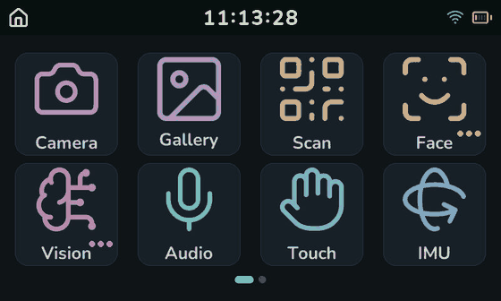

`GUI v0.1.02` | Apache-2.0 | MicroPython | LVGL

> This repository contains **application-layer Python code only**: the desktop, 23
> applications, the asset bakers and the serial deploy tools. It does not contain the
> firmware, the SDK or a BSP, and it does not redistribute the CanMV runtime.

## Contents

- [What this is](#what-this-is)
- [Features](#features)
- [Requirements](#requirements)
- [Quick start](#quick-start)
- [Repository layout](#repository-layout)
- [Architecture](#architecture)
- [Application list](#application-list)
- [Development guide](#development-guide)
- [Tool reference](#tool-reference)
- [Board knowledge index](#board-knowledge-index)
- [Troubleshooting](#troubleshooting)
- [Hardware specifications](#hardware-specifications)
- [Runtime dependencies and licensing](#runtime-dependencies-and-licensing)
- [Contributing](#contributing)
- [About the images](#about-the-images)

## What this is

A complete touch desktop that runs on the board as shipped:

- **Desktop**: a 4x2 paged grid, iOS-style folder flyouts, a status bar (clock,
  Wi-Fi, battery) and physical-key navigation. Every tile is pre-baked into an
  XRGB8888 bitmap on the PC or on the board, so a swipe only costs a few blits.
- **Applications**: 23 application modules covering camera, gallery, QR scan, audio,
  touch, IMU, network, settings and battery, plus the Vision and Face AI groups.
- **AI path**: 16 kmodels preloaded once and kept resident, so an application looks
  its model up in a dict instead of calling `load_kmodel` again.
- **Engineering support**: icon and tile bakers, serial incremental deploy, an
  on-board health check, reproducible probe scripts, and a `docs/` directory built
  from measured hardware facts.

**What it is not**: a firmware release, the K230 SDK, a Linux BSP, or a general LVGL
framework. To write LVGL code on K230 from scratch, read the upstream CanMV examples;
this project is a reference for what a finished desktop plus AI applications look like.

The `lvgl`, `image`, `media`, `nncase_runtime`, `aidemo`, `ulab` and `machine` modules
that applications import all come from the CanMV firmware. `stubs/*.pyi` are **type
descriptions written for this project** so a PC-side type checker stops flagging
board-only imports; they are not firmware source.

## Features

### Desktop and interaction

| Capability | Detail |
| --- | --- |
| 800x480 dark theme | Three luminance levels (background, tile, border); the brand cyan is used only for the clock and active indicators |
| Paged grid | 4x2 per page; the 11 top-level entries span two pages; a full page is centred, a partial last page starts top-left |
| Folders | `Vision` and `Face` groups; tapping opens a member picker; members do not consume tile cache |
| Status bar | 56 px: back-to-desktop on the left, bitmap clock in the middle, Wi-Fi and battery on the right |
| Physical keys | `GPIO0` = CANCEL (active low, steps back one level), `GPIO53` = OK (active high) |
| Swipe feel | 120 px threshold, 180 ms snap; `lv.refr_now()` boosting covers the touch and snap window |
| Backlight | Standalone GPIO25 PWM dimming; a settings change applies immediately and persists |

Page two holds only the entries you configure once (Network, Settings, Battery); the
daily set stays on page one. During a swipe only the tile grid scrolls: the status bar
and the page dots stay put, and because each icon is a pre-baked bitmap a full-screen
repaint is just a handful of blits.

Folder members skip the tile cache: the flyout draws a PNG icon plus an accent badge
directly.

| Vision group (9 members) | Face group (5 members) |
| --- | --- |
| 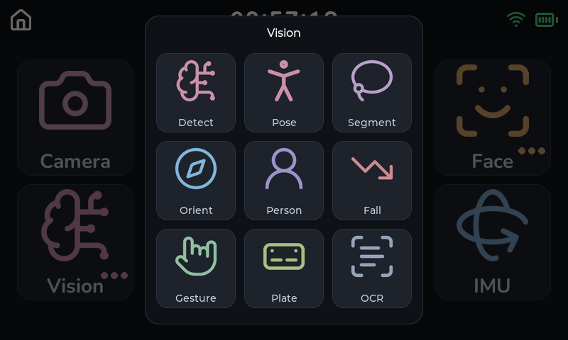 | 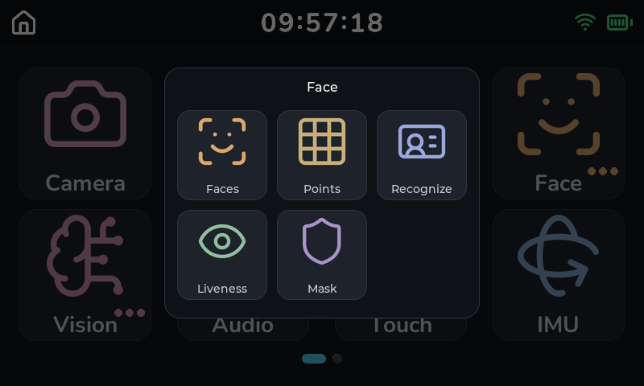 |

### Boot

The boot sequence drives a real progress bar weighted by **measured milliseconds**
rather than by item count:

1. Read the tile bitmap cache (on a miss, bake on the board and write it to disk)
2. Load 8 bitmap fonts (the OCR CJK font alone costs about 7.5 s and dominates the bar;
   the three UI CJK faces cost 569 ms, 584 ms and 193 ms)
3. Read the OCR dictionary
4. Load the 16 resident kmodels
5. Attempt a Wi-Fi connection (hard 15 s budget; on timeout the desktop still appears
   and no background retry happens afterwards)

The preload pays for itself in measurable terms: opening the OCR application drops
from 2151 ms to 253-320 ms. `BOOT_PRELOAD_MODELS` and `BOOT_PRELOAD_FONTS` in
`shell/boot.py` turn the preload off for comparison work.

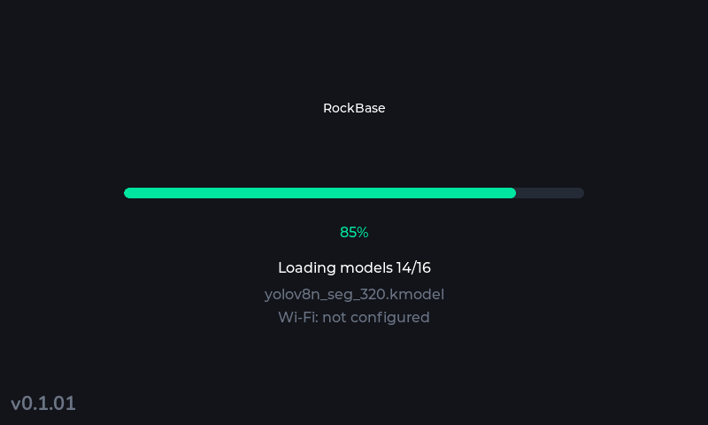

### AI applications

- **Vision group (9)**: Detect, Pose, Segment, Orient, Person, Fall, Gesture, Plate, OCR
- **Face group (5)**: Faces, Points, Recognize, Liveness, Mask
- One immersive shell: the application owns the whole screen, the status bar is
  hidden, and the physical CANCEL key exits
- Heavy applications use `release_home` to destroy the desktop and drop the tile cache
  on entry (about 1.5 MB of contiguous heap) and rebuild it from the SD cache on the
  way back (measured about 0.7 s)

OCR: the preview runs live; OK or a tap on the top bar freezes one frame and runs a
single detect plus recognise pass. Results are drawn over the picture and the bar
reports the line count and frame rate.

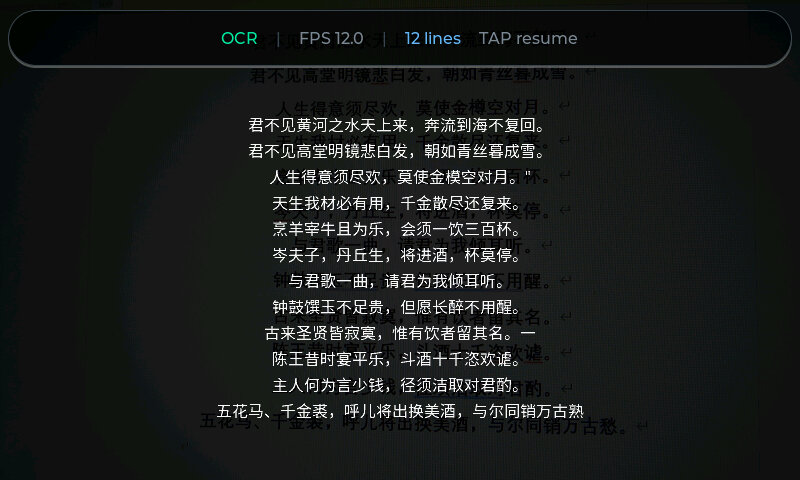

Detect: YOLOv8n 320 detects the 80 COCO classes live, with boxes and scores drawn over
the preview. The top bar switches between 4 models, including a fruit-only model and
YOLO26n.

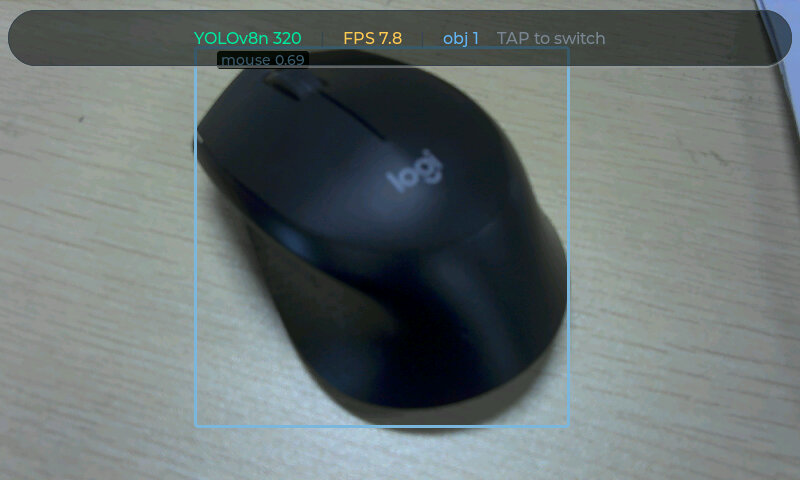

Plate: a two-stage chain (detect at 640x640, perspective crop, recognise at 220x32).
A caption is not a single-frame result: a new caption needs 4 consecutive agreeing
frames and a change to an existing caption needs 8, which stops a one-frame
misread from making the caption flicker.

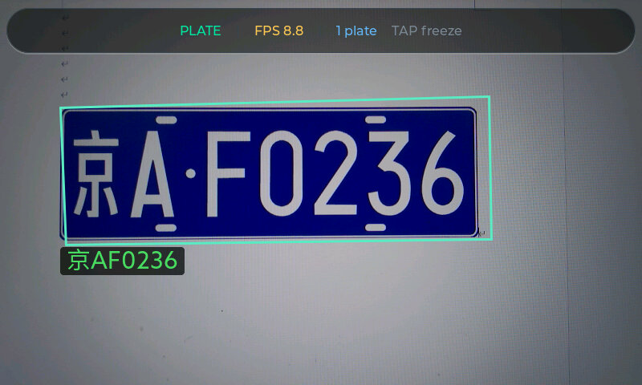

Points: RetinaFace finds the face, then a 106-point landmark model produces the mesh.
The top bar switches between Mesh, Contour and Off.

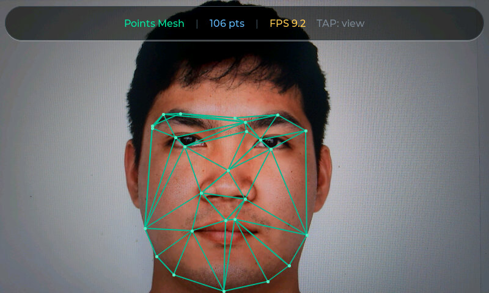

Pose: YOLO11n-pose produces a 17-keypoint skeleton, joints as coloured dots and limbs
as connecting lines, at about 25 ms of inference per frame.

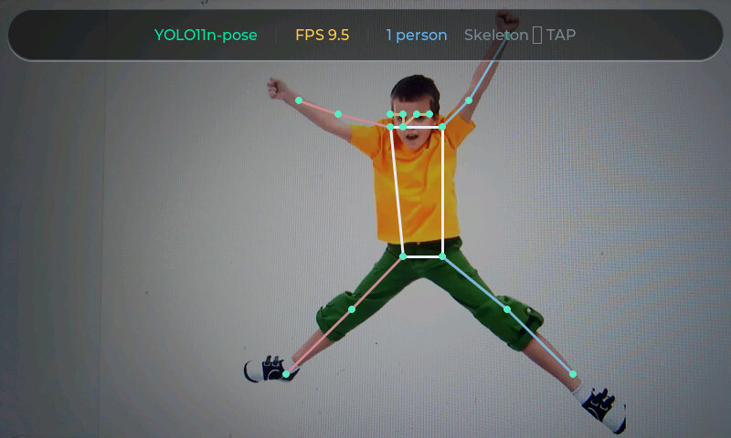

Gesture: hand_det locates the palm and handkp_det produces 21 hand keypoints, which an
angle rule classifies into 9 gestures (fist, five, gun, love, one, six, three,
thumbUp, yeah).

| Open palm, `five` | V sign, `yeah` |
| --- | --- |
| 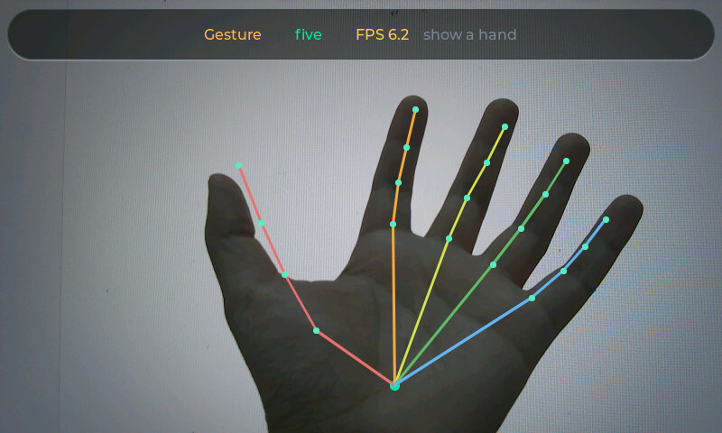 | 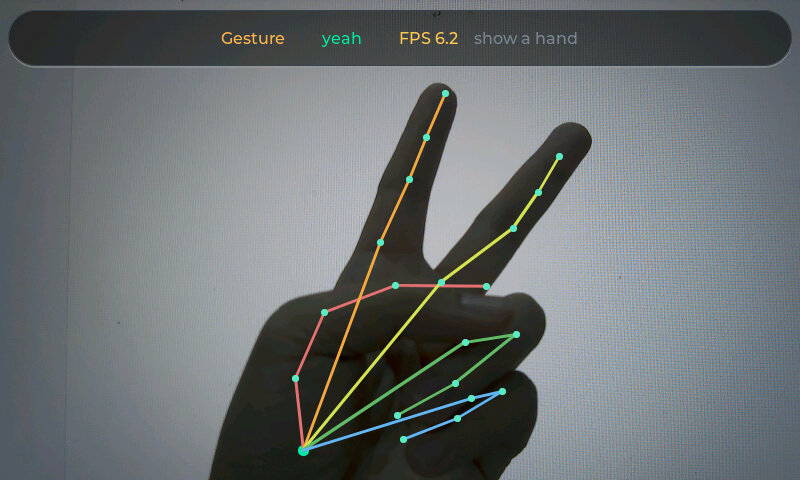 |

### Other applications

The system applications are drawn entirely in code as well, with no image assets:

| Settings | Audio |
| --- | --- |
| 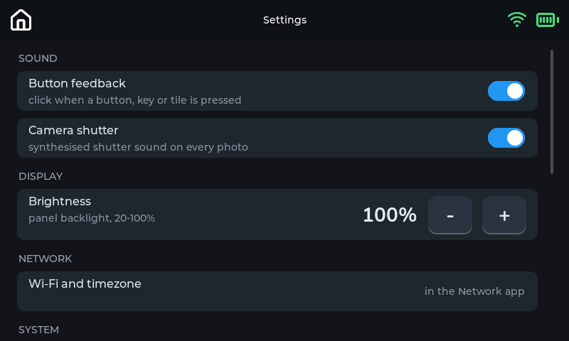 | 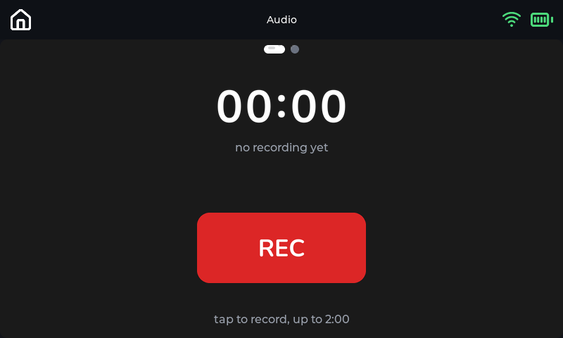 |

| Battery | IMU dashboard |
| --- | --- |
| 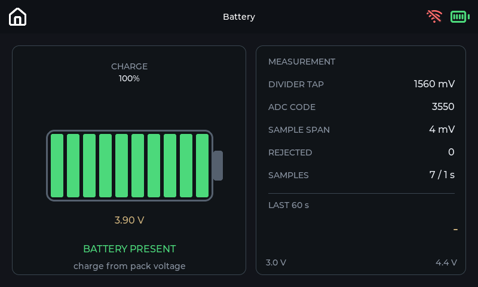 | 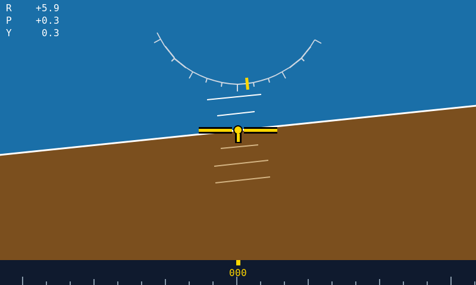 |

The IMU application has three pages you switch between by swiping: dashboard, raw data
curves and attitude curves. The dashboard above was captured with the board tilted
slightly right (roll +6 degrees), so the horizon is tilted with it.

| Raw data (acceleration, gyro, temperature) | Attitude curves (roll, pitch, yaw) |
| --- | --- |
| 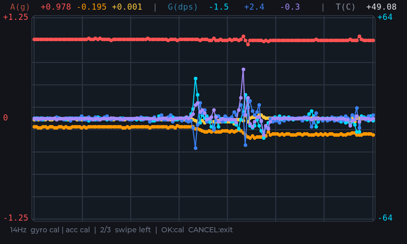 | 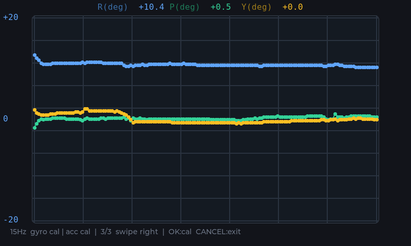 |

## Requirements

| Item | Requirement |
| --- | --- |
| SoC | K230 (the RockBase K230 Vision unit, or an equivalent K230 with an 800x480 panel) |
| Firmware | CanMV MicroPython for K230 built with the RockBase board configuration; see [Getting or building the RockBase firmware image](docs/firmware.md) |
| Display | 3.5-inch 800x480 capacitive touch panel (ST7701 + FT5316) |
| Board models | `/sdcard/examples/kmodel/` and `/sdcard/examples/utils/` come with the firmware image |
| PC | Python 3.11 (the development and verification environment; other versions untested), USB cable for the serial link |

Partition conventions:

- `/sdcard`: about 76 MB, deploy content only (`factory/gui`, `examples/kmodel`,
  `examples/utils`), and **only the deploy tools may write to it**.
- `/data`: about 28.6 GB. Every piece of runtime data (photos, caches, recordings,
  settings) goes under `/data/<app>/...`, so re-flashing the deploy partition does not
  lose it.

## Quick start

### 1. Prepare the firmware and the board

Flash the CanMV MicroPython firmware onto the K230, confirm the serial REPL answers, and
confirm the firmware image has placed `examples/kmodel` and `examples/utils` on the SD
card. The firmware is a separate artifact from this repository: see
[Getting or building the RockBase firmware image](docs/firmware.md) for the prebuilt
download locations, the `k230_canmv_rockbase_defconfig` source build, and the flash
procedure.

### 2. Prepare the PC environment

```powershell
git clone <this repository>
cd RockBase-K230-Vision
python -m venv .venv
.venv\Scripts\Activate.ps1
pip install -r requirements.txt
```

`requirements.txt` has two groups: serial transport (`pyserial`, `adafruit-ampy`) and
asset generation (`Pillow`, `svglib`, `reportlab`). If you only deploy and never
regenerate assets, the second group is optional.

### 3. Health check, then deploy

```powershell
python tools/_doctor.py
python tools/deploy_board.py --gui-only --autostart
```

`_doctor.py` checks, in the order that isolates the cause, every trap that has silently
hidden a deployed change: whether `/sdcard/main.py` is a stale copy, whether `ui/`,
`net/`, `audio/`, `core/` and `hardware/` are empty leftovers, whether the modules and
icons that `APPS` references exist, whether `BAKE_VER` matches, whether the tile caches
are stale, and whether the launcher imports resolve. It exits non-zero on failure, so it
works as a gate in front of a deploy script.

**When another USB serial device is plugged in, pass the port explicitly.** Auto
selection only excludes Bluetooth virtual ports and then takes the first candidate, so
an "ESP32 board plus K230" setup picks the wrong device and fails with
`failed to access COMx`:

```powershell
python tools/_doctor.py COM9
python tools/deploy_board.py COM9 --gui-only --autostart
```

`deploy_board.py` auto-selects a non-Bluetooth port, syncs incrementally at 921600 baud
and skips unchanged files by `sha256`; when it finishes it verifies every `.py` with
`compile()` on the board, compares byte counts and reports free space.

### 4. Reset and verify

After deploying, soft reset (or power cycle). You should see the boot progress bar and
then the desktop.

### Deploy command reference

| Command | Effect |
| --- | --- |
| `python tools/deploy_board.py` | Auto-select the port and deploy everything incrementally |
| `python tools/deploy_board.py COM56` | Use an explicit port |
| `python tools/deploy_board.py --gui-only` | Push `factory/gui` only |
| `python tools/deploy_board.py --autostart` | Also write `/sdcard/main.py` to autostart |
| `python tools/deploy_board.py --verify-only` | Verify only, write nothing |
| `python tools/deploy_board.py --dry-run` | Print the plan only |
| `python tools/deploy_board.py --force` | Ignore "already identical" and re-push everything |
| `python tools/deploy_board.py --smoke` | Extra on-board import smoke test |

> **Never pipe a deploy or probe through `grep`, `Select-String` or `Select-Object`.**
> Those commands redraw progress with `\r`, and a pipe buffers until the process exits,
> so the run looks frozen at `[PLAN]`.

## Repository layout

```text
.
├── factory/gui/                # all board-side code
│   ├── launcher.py             # entry point: sys.path bootstrap + main()
│   ├── shell/                  # home screen: theme, registry, tiles, display, touch, boot, Launcher
│   ├── apps/                   # one module per app (create_app/step/destroy)
│   ├── ui/                     # paging, keyboard, click tone, PNG loader
│   ├── net/                    # Wi-Fi, timezone, NTP
│   ├── audio/                  # record and playback, TTS, tones, pinyin table
│   ├── core/                   # config, i18n, version, errors, asset paths, pools
│   ├── hardware/               # backlight, ADC5 battery, camera geometry
│   └── assets/                 # icons, fonts, tile cache (cache/ is regenerable)
├── tools/
│   ├── deploy_board.py         # incremental serial deploy with closed-loop checks
│   ├── _doctor.py              # board health check
│   ├── gen_*.py                # offline icon / tile / font / pinyin generators
│   ├── _run_remote.py          # run a one-shot script on the board
│   └── probes/                 # reproducible measurement scripts
├── stubs/                      # type descriptions for the board API
├── models/                     # reference copies of the inference artefacts
├── docs/                       # measured board facts and the firmware build guide
└── img/                        # images used by the README
```

`factory/gui/assets/cache/` is generated output and can be deleted and re-baked.
Runtime data never goes on `/sdcard`: every file the GUI creates lives under
`/data/<owner>/`, where the owner is the app or subsystem that owns it.

`factory/gui/README.md` is the layer map for that tree
(`launcher.py -> shell/ -> apps/ -> ui/ net/ audio/ -> core/ -> hardware/`, imports
pointing only downward). Read it, and the `README.md` in the target directory, before
adding any file there.

## Architecture

### What happens during a boot

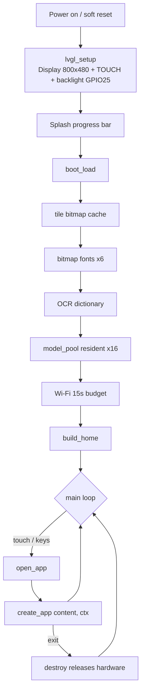

The main loop is a single-threaded state machine: each iteration calls `step()` on the
active application. Anything that blocks drops frames, so applications break long work
into small steps (network, recording and inference all follow that pattern).

### Application contract

```python
# factory/gui/apps/app_xxx.py
def create_app(content, ctx):
    """content: the lv.obj below the status bar; ctx: call ctx.request_exit() to leave."""
    ...
    return app   # needs step() and destroy()
```

| Contract | Meaning |
| --- | --- |
| `content` | The app mounts its UI here; a non-immersive app is screen height minus the 56 px status bar |
| `ctx.request_exit()` | Ask to return to the desktop; never delete a screen from inside an app |
| `step()` | Called once per main-loop iteration; must not block |
| `destroy()` | Called when returning to the desktop; releases the sensor, audio, ai2d and similar |

### Registry flags

| Flag | Effect |
| --- | --- |
| `folder: True` | The entry is a folder; tapping opens the member layer instead of an app |
| `immersive` | Hide the status bar and fill the screen; exit via physical CANCEL or `ctx.request_exit()` |
| `release_home` | Destroy the desktop and drop the tile cache before entry, freeing contiguous heap for heavy models; rebuilt on return |

Entries in `FOLDER_MEMBERS` use the same shape as top-level entries, so these flags
apply to members as well.

### Resource ownership

- **`core.model_pool`** owns every kpu it hands out. Applications **must not** call
  `release()`, which would take the model away from the next application. An app's
  `destroy()` frees only its own `Ai2d`, because the input geometry differs per app and
  cannot be shared.
- **`core.font_pool`** keeps a bitmap font resident after its first load, so the per-frame
  path never pays for `font_load` again.
- **`hardware.battery`, `hardware.backlight`, `net.service` and `ui.beep`** are
  singletons: the launcher initialises them and hands the handle to the application,
  which must not open a second one.

### Settings flow

```text
config.DEFAULTS  ──►  /data/settings/gui.json  ◄──  app_settings.GROUPS
                              │
                              └──►  consumers (launcher at boot / app at open)
```

There is no Save button: every change is written immediately. A missing or corrupt
settings file never blocks the GUI from starting; it falls back to the defaults and
prints one log line.

`ui.language` (`en` / `zh`) localizes the desktop and app text: tile names,
folder titles, member labels and every user-visible app string come from
`factory/gui/core/i18n.py`. A desktop change applies when the home screen is next
shown, with no reset needed: the launcher rebuilds it and reads the new language's
tile cache. Settings rebuilds its own page immediately; other apps read their
strings when they are opened, so an already-running app keeps its language.

## Application list

| Group | Application | Module | Main dependency |
| --- | --- | --- | --- |
| Desktop | Camera | `app_camera.py` | Camera, shutter sound |
| Desktop | Gallery | `app_gallery.py` | `/data/photos`, thumbnail cache |
| Desktop | Scan | `app_scan.py` | `find_qrcodes` on the greyscale channel |
| Desktop | Audio | `app_audio.py` | PDM record and playback |
| Desktop | Touch | `app_touch.py` | Touch panel |
| Desktop | IMU | `app_imu.py` | QMI8658A on I2C3 |
| Desktop | Network | `app_network.py` | `net.service` |
| Desktop | Settings | `app_settings.py` | `config`, board facts |
| Desktop | Battery | `app_battery.py` | ADC5 |
| Vision | Detect | `app_vision.py` | `yolov8n_320`, with 3 more switchable at runtime |
| Vision | Pose | `app_pose.py` | `yolo11n-pose` |
| Vision | Segment | `app_segment.py` | `yolov8n_seg_320` |
| Vision | Orient | `app_orient.py` | `yolo11n-obb` |
| Vision | Person | `app_person.py` | `person_detect_yolov5n` |
| Vision | Fall | `app_fall.py` | `yolov5n-falldown` |
| Vision | Gesture | `app_gesture.py` | `hand_det` + `handkp_det` (the 17th model, on demand) |
| Vision | Plate | `app_plate.py` | `yolo_license_plate_det` + `licence_reco` |
| Vision | OCR | `app_ocr.py` | `ocr_det_int16` + `ocr_rec_int16` |
| Face | Faces | `app_face_det.py` | `face_detection_320` |
| Face | Points | `app_face_points.py` | `face_detection_320` + `face_landmark` |
| Face | Recognize | `app_face_recognize.py` | `face_detection_320` + `face_recognition_mobile` + `face_liveness_rgb` |
| Face | Liveness | `app_face_liveness.py` | `face_detection_320` + `face_liveness_rgb` |
| Face | Mask | `app_mask.py` | `face_detection_320` + `face_parse` |

The three Detect alternates (`yolov8n_224`, `fruit_det_yolov8n_320`, `yolo26n`) stay on
demand on purpose: 16 resident models are verified, and 17 are verified when the
Sensor is created first and the extra model loads afterwards, but 19 resident has not
been measured and therefore is not part of the boot sequence.

## Development guide

### Adding an application

1. Create `factory/gui/apps/app_<name>.py` exporting `create_app(content, ctx)` and
   returning an object with `step()` and `destroy()`.
2. Add an entry to `APPS` in `shell/registry.py`, or to `FOLDER_MEMBERS` when it
   belongs to an existing folder.
3. If it needs its own icon, add the `id` to `ICONS` in `tools/gen_app_icons.py`
   **and** to `APP_ACCENTS` in `shell/registry.py` (a missing accent renders white). Members
   that reuse an existing PNG skip this step.
4. Generate the icons: `python tools/gen_app_icons.py` (needs
   `pip install svglib reportlab`).
5. Increment `BAKE_VER` in `shell/theme.py`, then re-bake:
   `python tools/gen_tile_cache.py` (top-level tiles only; folder members are not
   baked).
6. Deploy and verify: `python tools/deploy_board.py --gui-only`, soft reset, open the
   app.

### Adding a setting

1. Add the key and its default to `DEFAULTS` in `core/config.py`.
2. Add one row to `GROUPS` in `apps/app_settings.py`; the row types are `toggle`,
   `stepper`, `choice`, `info` and `action`.
3. Read the value where it is consumed: boot-time behaviour in the launcher, per-app
   behaviour in the application when it opens.

Do not import `launcher.py` from an application to reach a runtime handle. It runs via
`exec(open().read())`, so a reverse import executes it again and builds a second
Launcher. When shared hardware needs a new entry point, write a small module for it, as
`hardware/backlight.py` does.

### Changing a colour or size constant

The `COL_*`, `TILE_*`, `ICON_SIZE` and `NAME_COLOR` constants in `shell/theme.py` are
parsed by the `tools/gen_*.py` generators. After changing one you must:

1. Re-run the matching generator;
2. Increment `BAKE_VER`;
3. Deploy `assets/cache/` again.

Otherwise the board keeps loading the old bitmaps, and the symptom is "I changed the
code but the UI looks the same".

## Tool reference

| Script | Input to output |
| --- | --- |
| `tools/deploy_board.py` | Local `factory/gui` to `/sdcard/factory/gui`, incremental plus verification |
| `tools/_doctor.py` | Read-only: check the deployed state item by item |
| `tools/gen_app_icons.py` | `assets/src_*.svg` plus `APP_ACCENTS` to `assets/icon_*.png` |
| `tools/gen_tile_cache.py` | Icons plus `TILE_*` constants to `assets/cache/tile_*.bin` |
| `tools/gen_member_icons.py` | 64 px icons for folder members |
| `tools/gen_status_icons.py` | Lucide SVG to status-bar home, wifi and battery bitmaps |
| `tools/gen_clock_digits.py` | Nunito Bold to status-bar clock digit bitmaps |
| `tools/gen_font.py` | A charset plus a TTF to a bitmap font `.bin` |
| `tools/gen_pinyin_map.py` | The pinyin table at `audio/pinyin_map.py` |
| `tools/gen_audio_assets.py` | Digit and button bitmaps for the Audio app |
| `tools/gen_face_mesh.py` | The face-mesh tables |
| `tools/gen_tz_rows.py` | The timezone wheel bitmaps |
| `tools/gen_touch_hint.py` | The multi-touch hint bitmap |
| `tools/decode_lv_snapshot.py` | An LVGL snapshot exported from the board to PNG |
| `tools/make_swipe_gif.py` | Swipe stills to the README GIF (re-timed, status bar frozen) |
| `tools/_check_readme_facts.py` | Read-only: verify the counts and constants the README claims |
| `tools/_run_remote.py` | Run a local script on the board and collect its output |
| `tools/probes/*.py` | One-shot measurement scripts that reproduce the values in `docs/` |

Probes are not a test suite; they are **measurement tools**. Each script terminates on
its own and cleans up the hardware it touched. Add `--lvgl` whenever the script creates
any `lv` object or calls `lv.task_handler()`; without it the first widget creation hangs
the board.

## Board knowledge index

Board behaviour here is measured, not guessed. Read these before writing a new
application or a new probe:

| Document | When you must read it |
| --- | --- |
| [`docs/board-ai-runtime.md`](docs/board-ai-runtime.md) | Using Ai2d or the KPU, writing post-processing, debugging memory and tensor lifetime |
| [`docs/board-hardware.md`](docs/board-hardware.md) | Camera, IMU, ADC, microphone, amplifier, video decoding |
| [`docs/lvgl-binding.md`](docs/lvgl-binding.md) | What this LVGL binding exposes, its rendering model and touch semantics |
| [`docs/performance-budget.md`](docs/performance-budget.md) | Per-frame costs and the 20 ms main-loop budget |
| [`docs/reset-matrix.md`](docs/reset-matrix.md) | Which failure a soft reset clears and which needs a power cycle |
| [`docs/pitfalls.md`](docs/pitfalls.md) | Cross-cutting trap index: symptom, cause, what to do instead |

The traps most likely to be hit, and the most costly when they are:

1. **Never delete the LVGL active screen.** Load another screen first; otherwise touch
   input stops working entirely.
2. **The AI camera channel must use `RGBP888` when ai2d declares `NCHW_FMT`.** A packed
   format collapses the scores to noise while per-channel statistics still look normal.
3. **Release every KPU tensor right after `to_numpy()`.** A missed release leaks native
   memory and drops the serial link; only a power cycle recovers it.
4. **Call `stop_stream()` before `close()` on an audio stream.** The reverse order
   hard-hangs the board.
5. **Construct `Sensor()` at most once per VM lifetime.** Neither `destroy()` nor a soft
   reset releases it.
6. **Write runtime data only under `/data/<app>/`.** `/sdcard` is written by the deploy
   tools alone.

The complete list is in [`docs/pitfalls.md`](docs/pitfalls.md) and the
`## Board constraints` section of [`AGENTS.md`](AGENTS.md).

## Troubleshooting

**First rule: before blaming "the code did not take effect", run
`python tools/_doctor.py`.**

| Symptom | Check first |
| --- | --- |
| Code changed, board unchanged | Soft reset; confirm `BAKE_VER` matches the caches; run `_doctor.py` |
| Black screen at boot but the logs look healthy | The backlight is a separate GPIO25 pin that `Display.init()` leaves alone |
| An app shows "camera unavailable" | A `NameError` inside the app may be swallowed by `except BaseException`; run `python -m pyflakes` |
| Deploy hangs at `[PLAN]` | Do not pipe it; run `deploy_board.py` bare |
| A file is 0 bytes after deploying | `open('wb')` truncates before writing, so an interrupted transfer leaves an empty file; re-push that file and compare sizes |
| Preview framing or scale is wrong | The preview and AI channels need the same aspect and the same explicit window |
| A model fails to load | Confirm `/sdcard/examples/kmodel/` came from the firmware image; the deploy tool does not push those files |

More symptom-to-cause pairs are in [`docs/pitfalls.md`](docs/pitfalls.md).

## Hardware specifications

The unit this repository runs on (figures from the hardware side), useful for judging
portability. This GUI needs the display configuration: the screenless standard edition
cannot show a desktop and only works as a serial vision module.

| Item | Value |
| --- | --- |
| Processor | Dual-core 64-bit RISC-V (1.6 GHz big core plus 800 MHz little core) |
| AI compute | KPU, about 6 TOPS equivalent (third-generation KPU) |
| Memory | 1 GB LPDDR4 standard, 2 GB LPDDR4 optional |
| Display | 3.5-inch 800x480 capacitive touch panel (deluxe edition) |
| Camera | MIPI CSI-2, up to 3 inputs, up to 1080P at 60 fps |
| Audio | PDM microphone input plus an audio amplifier output |
| Wireless | Wi-Fi IEEE 802.11 b/g/n |
| Peripherals | USB 2.0, UART, I2C, SPI, PWM, GPIO, SD/eMMC |
| Operating systems | Linux and RT-Smart; this GUI runs on CanMV MicroPython |
| Mechanics | ABS housing; several mounting brackets and a two-axis motorised pan-tilt |
| Editions | Standard (no panel) and deluxe (with the 3.5-inch touch panel) |

For low-level K230 work, use the official Canaan material:
[K230 documentation](https://github.com/kendryte/k230_docs),
[K230 SDK](https://github.com/kendryte/k230_sdk) and
[K230 CanMV](https://github.com/kendryte/k230_canmv/).

## Runtime dependencies and licensing

This repository contains **application-layer Python code only**. It does not include the
runtime environment and does not redistribute any part of it.

The GUI runs on the **CanMV MicroPython firmware** for K230, which provides every
board-only module the applications import. Obtain and install that firmware from Canaan;
nothing here replaces it.

| Component | Maintained by | Terms |
| --- | --- | --- |
| CanMV firmware (`canmv_k230`) | Canaan | No licence file published upstream as of 2026-10; consult the upstream repository |
| K230 SDK | Canaan | BSD-2-Clause, Copyright (c) 2023 Canaan Bright Sight Co., Ltd |
| LVGL | The LVGL project | MIT |

### Inference artefacts

`models/kmodel/` and `models/utils/` are **reference copies** of two directories in the
official CanMV firmware image, unmodified:

| Here | Board path (provided by the firmware image) | Origin |
| --- | --- | --- |
| `models/kmodel/*.kmodel` | `/sdcard/examples/kmodel/` | K230 SDK `src/rtsmart/libs/kmodel/ai_poc/kmodel/` |
| `models/utils/prior_data_320.bin` | `/sdcard/examples/utils/` | Same, the face-detection anchor data |

Applications load them from the board path, which the CanMV firmware image already
provides; `tools/deploy_board.py` does not push these files. They are kept here so the
dependency list, file names and byte counts are reviewable without unpacking a firmware
image, and so a model swap is a reviewable diff.

These files belong to Canaan and remain under their origin terms, not this project's
Apache-2.0 licence; the vision applications are only usable together with that firmware
anyway.

### Licence

Released under the **Apache License 2.0**. See [LICENSE](LICENSE) for the full text.

Third-party components bundled here keep their own terms: Lucide icons (ISC), the
Nunito and Font Awesome fonts (SIL OFL / CC BY 4.0) and DejaVu Sans Mono (Bitstream
Vera). The full attribution list is `factory/gui/assets/LICENSE.txt`.

## Contributing

Issues and pull requests are welcome. Before committing, walk through the
`## Consistency check` section of [`AGENTS.md`](AGENTS.md), in particular:

- Values and thresholds in comments, docstrings and `docs/` must match the code
  constants;
- Changing `APPS` means confirming the module, the icon and the `APP_ACCENTS` row all
  exist;
- Changing a baking constant means re-running the generator and incrementing
  `BAKE_VER`;
- `README.md` and `README_zh.md` stay in sync;
- Commit messages are **English** and contain no non-ASCII characters; files tracked
  by git are written in English, and Chinese only appears in the matching `*_zh.md`
  counterpart (see [AGENTS.md](AGENTS.md)).

## About the images

Every image was exported from the board as an LVGL snapshot and was not retouched.
Capture status, the shooting procedure and the scene list for the remaining
screenshots are in [`img/README.md`](img/README.md).
