# RockBase K230 Vision GUI

简体中文 | [English](README.md)

面向 K230（CanMV MicroPython）的 800×480 触屏桌面系统与边缘 AI 应用集。

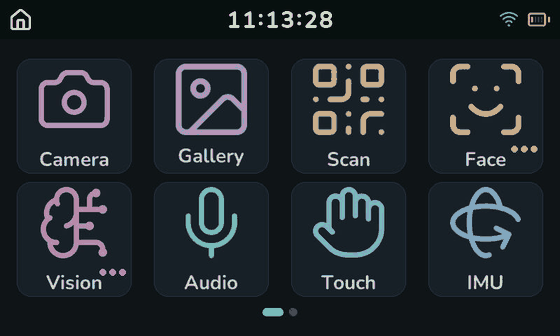

`GUI v0.1.01` · Apache-2.0 · MicroPython · LVGL

> 本仓库只包含**应用层 Python 代码**：桌面、23 个应用、资源烘焙与串口部署工具。
> 它不含固件、SDK 或 BSP，也不分发 CanMV 运行时。

## 目录

- [这是什么](#这是什么)
- [功能特性](#功能特性)
- [运行前提](#运行前提)
- [快速开始](#快速开始)
- [目录结构](#目录结构)
- [架构](#架构)
- [应用清单](#应用清单)
- [开发指南](#开发指南)
- [工具链速查](#工具链速查)
- [板端知识索引](#板端知识索引)
- [排障](#排障)
- [硬件规格](#硬件规格)
- [运行时依赖与许可](#运行时依赖与许可)
- [参与贡献](#参与贡献)
- [图片说明](#图片说明)

## 这是什么

一套完整的、可直接上板的触屏桌面系统：

- **桌面**：4×2 分页网格、iOS 风格文件夹二级飞出、状态栏（时钟 / Wi-Fi / 电量）、
  物理按键导航。每个 tile 都在 PC 或板上预烘焙成 XRGB8888 位图，滑动时只做 blit。
- **应用**：23 个应用模块，覆盖相机、图库、扫码、音频、触摸、IMU、网络、设置、电池，
  以及视觉与人脸两个 AI 分组。
- **AI 链路**：16 个 kmodel 常驻预加载，应用内部只做字典查找，不再重复 `load_kmodel`。
- **工程配套**：图标与 tile 缓存生成器、串口增量部署、板端体检脚本、可复现的探针脚本，
  以及按硬件事实整理的 `docs/`。

**它不是**：固件发行版、K230 SDK、Linux BSP，也不是通用 LVGL 框架。
想在 K230 上从零写 LVGL 程序，请直接看上游 CanMV 示例；本项目是一份
“把桌面系统和 AI 应用真正做完整”的参考实现。

应用 import 的 `lvgl`、`image`、`media`、`nncase_runtime`、`aidemo`、`ulab`、`machine`
全部由 CanMV 固件提供。`stubs/*.pyi` 是**为本项目编写的类型描述**，让 PC 端类型检查
不把板端 import 判为错误，它不是固件源码。

## 功能特性

### 桌面与交互

| 能力 | 说明 |
| --- | --- |
| 800×480 深色主题 | 三级明度（背景 / tile / 描边），品牌青色只用于时钟与激活指示 |
| 分页网格 | 每页 4×2，11 个顶层入口分两页；整页居中、末页左对齐 |
| 文件夹 | `Vision` / `Face` 两个分组，点击后弹出成员选择层；成员不占 tile 缓存 |
| 状态栏 | 56px，左侧返回桌面、中间位图时钟、右侧 Wi-Fi 与电量 |
| 物理按键 | `GPIO0` = CANCEL（低有效，逐级返回），`GPIO53` = OK（高有效） |
| 滑动手感 | 阈值 120px、吸附动画 180ms；`lv.refr_now()` 帧率提升覆盖触摸与吸附过程 |
| 背光控制 | 独立 GPIO25 PWM 调光，设置项即时生效并持久化 |

第二页只放“配置一次就不再动”的入口（Network / Settings / Battery），
日常使用的应用留在第一页。滑动时只有图标网格在滚动，状态栏与页码点保持不动；
每块图标是一个预烘焙位图，因此整屏重绘也只是若干次 blit。

文件夹不入 tile 缓存，点击时用 PNG 图标 + accent 色徽章即时绘制：

| Vision 组（9 个成员） | Face 组（5 个成员） |
| --- | --- |
| 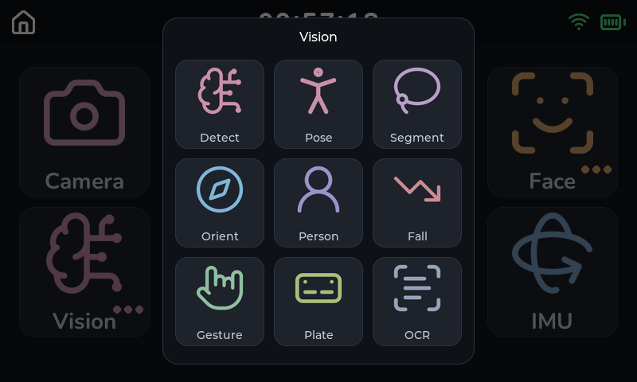 | 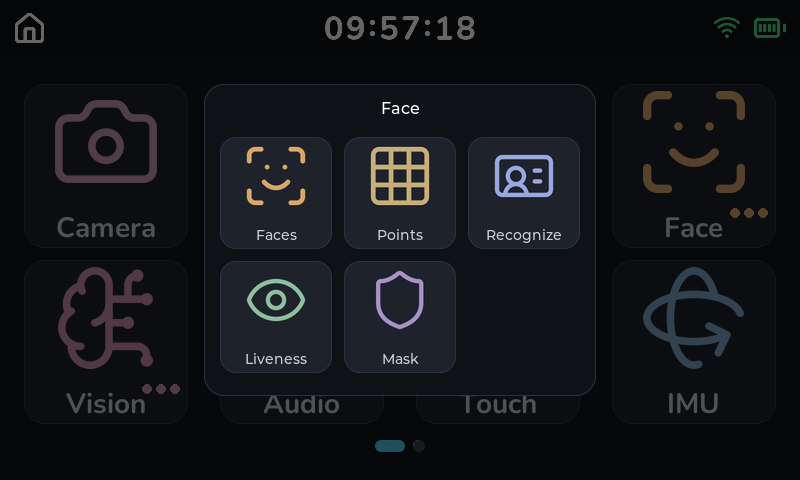 |

### 启动

启动阶段带真实进度条，按**实测毫秒权重**推进（不是按条目数均分）：

1. 读取 tile 位图缓存（未命中则在板上现场烘焙并写盘）
2. 加载 5 套位图字体（其中 OCR CJK 字体单套约 7.5 s，占进度条大头）
3. 读取 OCR 字典
4. 常驻加载 16 个 kmodel
5. 尝试 Wi-Fi 连接（硬性 15 s 预算，超时照常进桌面，之后不再后台重连）

预加载的收益是可量化的：OCR 应用的打开耗时从 2151 ms 降到 253–320 ms。
`launcher.py` 里的 `BOOT_PRELOAD_MODELS` / `BOOT_PRELOAD_FONTS` 可以关掉预加载用于对比调试。

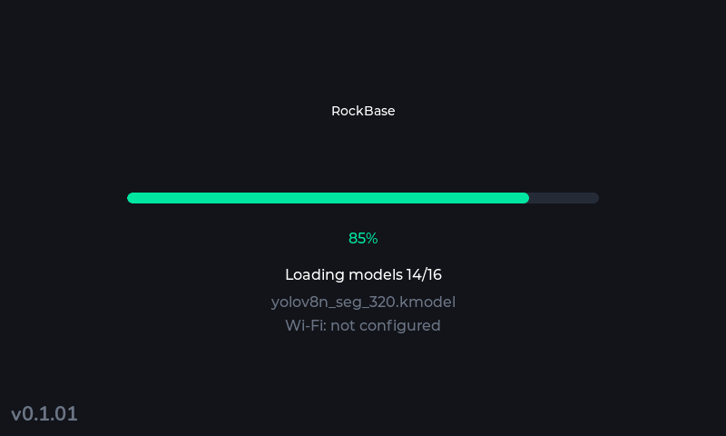

### AI 应用

- **视觉组（9）**：Detect、Pose、Segment、Orient、Person、Fall、Gesture、Plate、OCR
- **人脸组（5）**：Faces、Points、Recognize、Liveness、Mask
- 统一的沉浸式外壳：应用独占全屏、隐藏状态栏、按物理 CANCEL 退出
- 重型应用通过 `release_home` 在进入时释放桌面与 tile 缓存（约 1.5 MB 连续堆），
  返回时从 SD 缓存重建（实测约 0.7 s）

OCR 应用：预览实时刷新，按 OK 或点击顶栏冻结一帧并跑一次检测 + 识别，
结果叠加在画面上，顶栏显示行数与帧率：

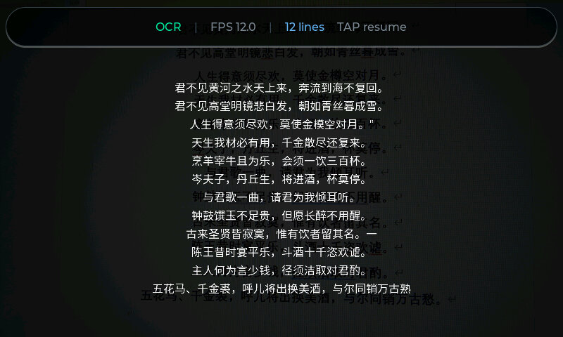

Detect 应用：YOLOv8n 320 实时检测 80 类 COCO 目标，框与置信度直接叠加在预览上，
顶栏可切换 4 个模型（含水果专用模型与 YOLO26n）：

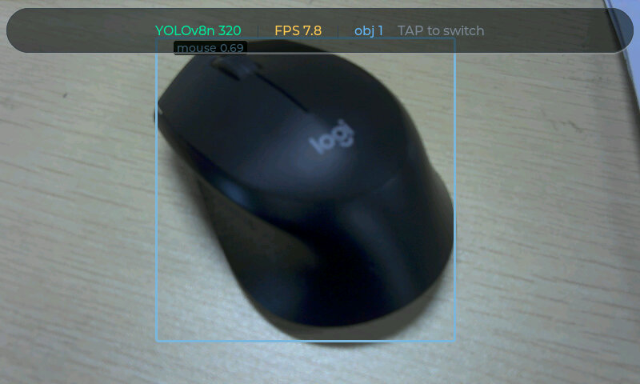

Plate 应用：两段式链路（检测 640×640 → 透视裁切 → 识别 220×32），
字幕不是单帧输出：新字幕需连续 4 帧一致才显示，已有字幕改判需连续 8 帧，
避免单帧误识别导致字幕闪烁：

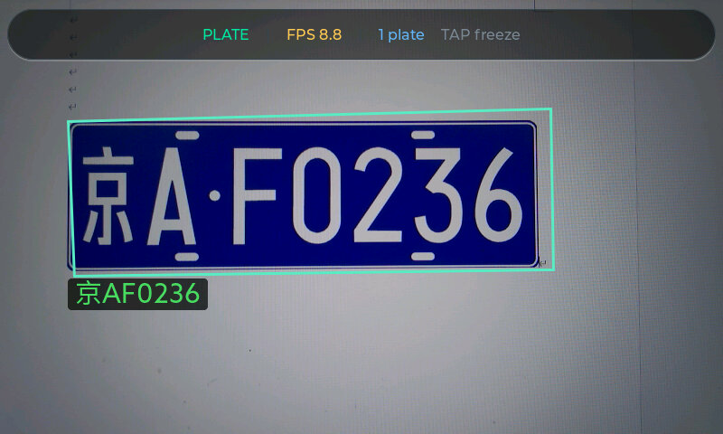

Points 应用：RetinaFace 检测人脸后由 106 点关键点模型输出网格，
顶栏可切换 Mesh / Contour / Off 三种显示：

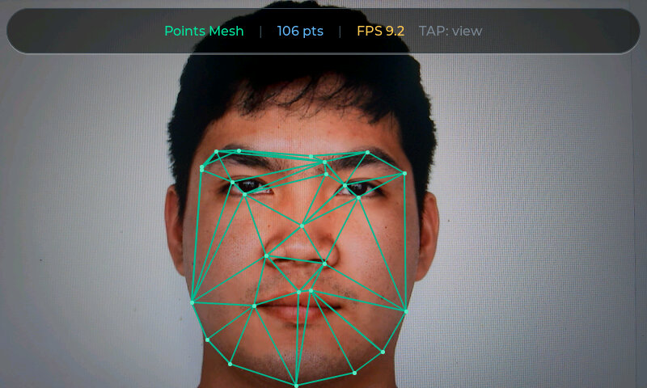

Pose 应用：YOLO11n-pose 输出 17 个关键点骨架，关节用彩色圆点、肢体用连线绘制，
单帧推理约 25 ms：

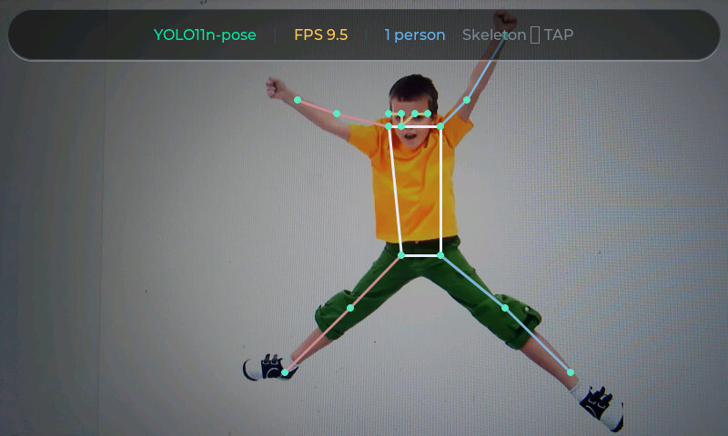

Gesture 应用：hand_det 定位手掌、handkp_det 输出 21 个手部关键点，
再由角度规则分类成 9 种手势（fist / five / gun / love / one / six / three / thumbUp / yeah）：

| 张开手掌 · `five` | V 字 · `yeah` |
| --- | --- |
| 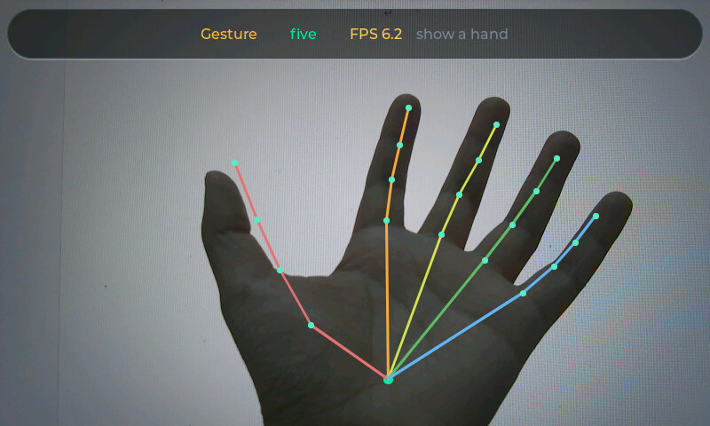 | 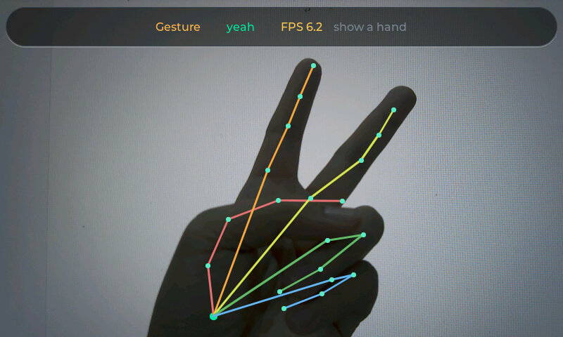 |

### 其它应用

系统类应用同样全部自绘，不依赖图片素材：

| Settings | Audio |
| --- | --- |
| 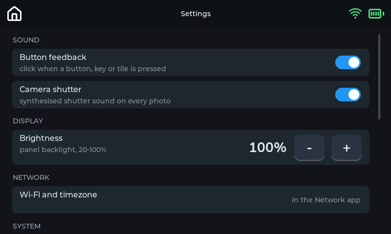 | 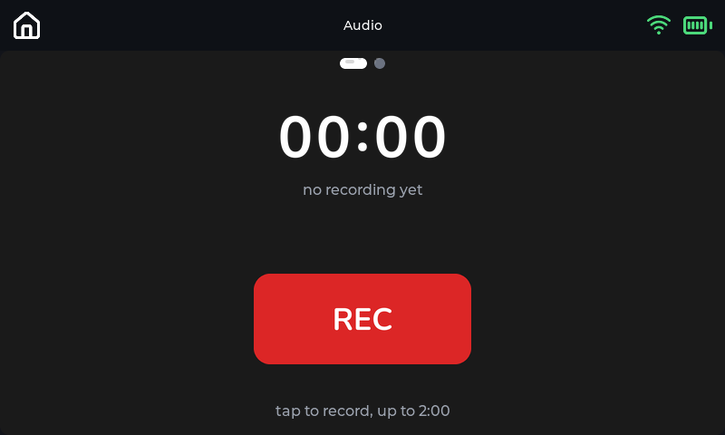 |

| Battery | IMU 仪表盘 |
| --- | --- |
| 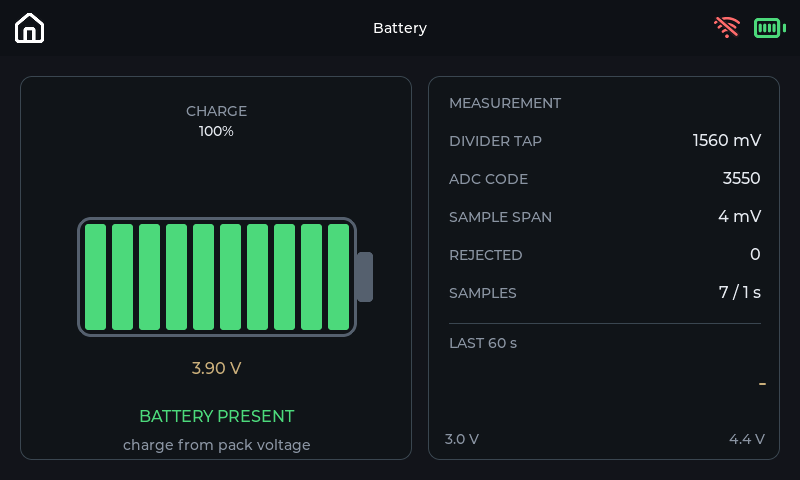 | 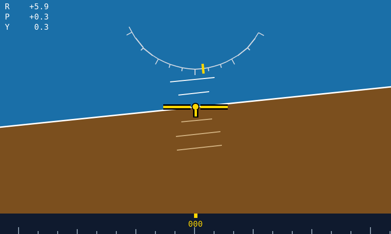 |

IMU 应用有三页，左右滑动切换：仪表盘、原始数据曲线、姿态角曲线。
上图为仪表盘，板子略向右倾（roll +6°），地平线随之倾斜：

| 原始数据（加速度 / 角速度 / 温度） | 姿态角曲线（roll / pitch / yaw） |
| --- | --- |
| 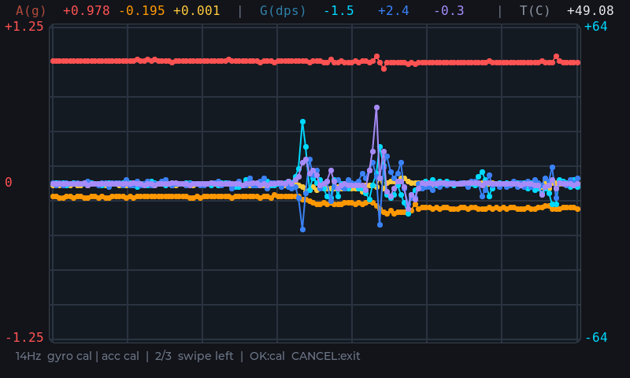 | 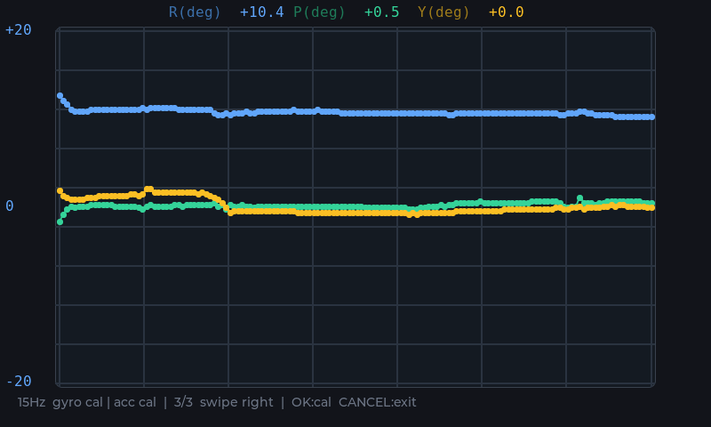 |

## 运行前提

| 项目 | 要求 |
| --- | --- |
| 主控 | K230（RockBase K230 Vision 整机，或等价的 K230 + 800×480 屏方案） |
| 固件 | 用 RockBase 板级配置构建的 CanMV MicroPython，见[获取或编译 RockBase 镜像](docs/firmware_zh.md) |
| 显示 | 3.5 英寸 800×480 电容触摸屏（ST7701 + FT5316） |
| 板上模型 | `/sdcard/examples/kmodel/` 与 `/sdcard/examples/utils/` 由固件镜像提供 |
| PC 端 | Python 3.11（开发与验证环境；其它版本未实测）、USB 数据线（串口直连） |

分区约定：

- `/sdcard`：约 76 MB，只放部署内容（`factory/gui`、`examples/kmodel`、`examples/utils`），
  **只允许部署工具写入**。
- `/data`：约 28.6 GB。所有运行时数据（照片、缓存、录音、设置）一律写
  `/data/<app>/...`，重刷部署分区不会丢。

## 快速开始

### 1. 准备固件与板卡

给 K230 刷入 CanMV MicroPython 固件，确认串口 REPL 可用，并确认固件镜像已把
`examples/kmodel`、`examples/utils` 放到 SD 卡。固件与本仓库是两个独立产物：
预编译镜像的下载地址、基于 `k230_canmv_rockbase_defconfig` 的源码编译流程，
以及烧录步骤，都写在[获取或编译 RockBase 镜像](docs/firmware_zh.md)里。

### 2. 准备 PC 环境

```powershell
git clone <本仓库地址>
cd RockBase-K230-Vision
python -m venv .venv
.venv\Scripts\Activate.ps1
pip install -r requirements.txt
```

`requirements.txt` 分两组：串口通信（`pyserial`、`adafruit-ampy`）与
资源生成（`Pillow`、`svglib`、`reportlab`）。只部署不改资源时，第二组可以不装。

### 3. 先体检，再部署

```powershell
python tools/_doctor.py
python tools/deploy_board.py --gui-only --autostart
```

`_doctor.py` 按“最容易掩盖问题”的顺序逐项检查：`/sdcard/main.py` 是否是旧拷贝、
`ui/`/`net/`/`audio/` 是否是空目录、`APPS` 引用的模块与图标是否缺失、
`BAKE_VER` 是否一致、tile 缓存是否过期、launcher 的 import 能否解析。
失败返回非零，适合放在部署脚本前面当闸门。

**机器上同时插着别的 USB 串口设备时，必须显式给端口。** 自动选择只排除蓝牙虚拟串口，
取第一个候选，因此在“ESP32 板 + K230”这类组合下会选错设备并报 `failed to access COMx`：

```powershell
python tools/_doctor.py COM9
python tools/deploy_board.py COM9 --gui-only --autostart
```

`deploy_board.py` 自动选择非蓝牙串口，以 921600 波特率增量同步，
按 `sha256` 跳过未变化文件；完成后会在板上用 `compile()` 校验每个 `.py`、
比对字节数、报告剩余空间。

### 4. 复位并验收

部署后软复位（或断电重启），应看到启动进度条，随后进入桌面。

### 部署命令速查

| 命令 | 作用 |
| --- | --- |
| `python tools/deploy_board.py` | 自动选口，增量部署全部内容 |
| `python tools/deploy_board.py COM56` | 指定串口 |
| `python tools/deploy_board.py --gui-only` | 只推 `factory/gui` |
| `python tools/deploy_board.py --autostart` | 额外写入 `/sdcard/main.py` 开机自启 |
| `python tools/deploy_board.py --verify-only` | 只校验，不写文件 |
| `python tools/deploy_board.py --dry-run` | 只打印计划 |
| `python tools/deploy_board.py --force` | 忽略“已一致”判断，全量重推 |
| `python tools/deploy_board.py --smoke` | 额外做板上 import 冒烟测试 |

> **不要给部署或探针命令接 `| grep` / `Select-String` / `Select-Object`。**
> 这些命令按 `\r` 原地刷新进度，管道会缓冲到进程退出才输出，看起来像卡死在 `[PLAN]`。

## 目录结构

```text
.
├── factory/gui/                # 全部板端代码
│   ├── launcher.py             # 启动、桌面、tile 烘焙、应用注册表
│   ├── version.py              # GUI_VERSION
│   ├── config.py               # /data/settings/gui.json 读写与默认值
│   ├── model_pool.py           # 常驻 kpu 池（应用不得 release）
│   ├── font_pool.py            # 常驻位图字体
│   ├── ocr_dict.py             # OCR 字典
│   ├── camera_fov.py           # 双通道取景窗对齐
│   ├── batt.py                 # ADC5 电池采样（状态栏与应用共用）
│   ├── apps/                   # 每个应用一个模块（create_app/step/destroy）
│   ├── ui/                     # paging / splash / backlight / beep / kb_layer
│   ├── net/                    # Wi-Fi 连接、时区、NTP
│   ├── audio/                  # 录音回放、TTS、提示音、拼音表
│   └── assets/                 # 图标、字体、tile 缓存（cache/ 可重新生成）
├── tools/
│   ├── deploy_board.py         # 串口增量部署 + 闭环校验
│   ├── _doctor.py              # 板卡体检
│   ├── gen_*.py                # 图标 / tile / 字体 / 拼音等离线生成器
│   ├── _run_remote.py          # 在板上跑一次性脚本
│   └── probes/                 # 可复现的测量脚本
├── stubs/                      # 板端 API 类型描述
├── models/                     # 推理产物参考副本（板上由固件镜像提供）
├── docs/                       # 板端实测事实与固件编译说明
└── img/                        # README 与文档用图
```

`factory/gui/assets/cache/` 是生成产物，可以删除后重新烘焙；
`apps/` 之外的任何文件都不应该写运行时数据。

`factory/gui/README.md` 是该目录的分层表
（`launcher.py -> shell/ -> apps/ -> ui/ net/ audio/ -> core/ -> hardware/`，
import 只能向下）。新增文件前先读它，以及目标目录自己的 `README.md`。

## 架构

### 一次开机发生了什么

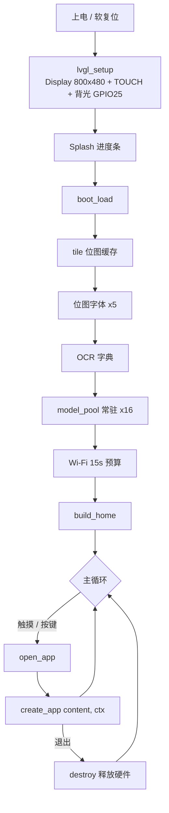

主循环是单线程状态机：每次迭代调用当前应用的 `step()`，任何阻塞操作都会掉帧，
所以应用必须把耗时工作拆成小步（网络、录音、模型推理都是这个模式）。

### 应用契约

```python
# factory/gui/apps/app_xxx.py
def create_app(content, ctx):
    """content: 状态栏以下的 lv.obj；ctx: 退出用 ctx.request_exit()"""
    ...
    return app   # 需要 step() 与 destroy()
```

| 约定 | 含义 |
| --- | --- |
| `content` | 应用把 UI 挂在它上面；非沉浸式应用高度为屏高减 56px 状态栏 |
| `ctx.request_exit()` | 请求返回桌面，不要在应用里直接删屏 |
| `step()` | 每轮主循环调用一次，必须非阻塞 |
| `destroy()` | 返回桌面时调用，释放 sensor / 音频 / ai2d 等资源 |

### 注册表里的控制标志

| 标志 | 作用 |
| --- | --- |
| `folder: True` | 该条目是文件夹，点击打开成员层而不是应用 |
| `immersive` | 隐藏状态栏、内容区占满全屏；退出走物理 CANCEL 或 `ctx.request_exit()` |
| `release_home` | 进入前销毁桌面并释放 tile 缓存，为重模型腾出连续堆；返回时重建 |

`FOLDER_MEMBERS` 的条目与顶层条目结构相同，因此这些标志对成员同样生效。

### 资源所有权

- **`model_pool`**：拥有它发出的每一个 kpu。应用**不得**调用 `release()`，
  否则会把模型从下一个应用手里拿走。应用的 `destroy()` 只释放自己的 `Ai2d`
  （输入几何随应用不同，不能共享）。
- **`font_pool`**：位图字体按需加载后常驻，避免每帧重复 `font_load`。
- **`batt` / `backlight` / `net.service` / `beep`**：都是单例，launcher 初始化后
  把句柄交给应用，应用不要自己再开一份。

### 配置流

```text
config.DEFAULTS  ──►  /data/settings/gui.json  ◄──  app_settings.GROUPS
                              │
                              └──►  消费方（launcher 启动期 / 应用打开时）
```

设置项没有“保存”按钮，改一次写一次盘。缺失或损坏的配置文件不会阻止 GUI 启动，
会用默认值继续并打印一行日志。

## 应用清单

| 分组 | 应用 | 模块 | 主要依赖 |
| --- | --- | --- | --- |
| 桌面 | Camera | `app_camera.py` | 摄像头、快门音 |
| 桌面 | Gallery | `app_gallery.py` | `/data/photos`、缩略图缓存 |
| 桌面 | Scan | `app_scan.py` | `find_qrcodes`（灰度通道） |
| 桌面 | Audio | `app_audio.py` | PDM 录音 / 播放 |
| 桌面 | Touch | `app_touch.py` | 触摸面板 |
| 桌面 | IMU | `app_imu.py` | QMI8658A（I2C3） |
| 桌面 | Network | `app_network.py` | `net.service` |
| 桌面 | Settings | `app_settings.py` | `config`、板端信息 |
| 桌面 | Battery | `app_battery.py` | ADC5 |
| Vision | Detect | `app_vision.py` | `yolov8n_320`（可运行时切换另外 3 个） |
| Vision | Pose | `app_pose.py` | `yolo11n-pose` |
| Vision | Segment | `app_segment.py` | `yolov8n_seg_320` |
| Vision | Orient | `app_orient.py` | `yolo11n-obb` |
| Vision | Person | `app_person.py` | `person_detect_yolov5n` |
| Vision | Fall | `app_fall.py` | `yolov5n-falldown` |
| Vision | Gesture | `app_gesture.py` | `hand_det` + `handkp_det`（第 17 个按需加载） |
| Vision | Plate | `app_plate.py` | `yolo_license_plate_det` + `licence_reco` |
| Vision | OCR | `app_ocr.py` | `ocr_det_int16` + `ocr_rec_int16` |
| Face | Faces | `app_face_det.py` | `face_detection_320` |
| Face | Points | `app_face_points.py` | `face_detection_320` + `face_landmark` |
| Face | Recognize | `app_face_recognize.py` | `face_detection_320` + `face_recognition_mobile` + `face_liveness_rgb` |
| Face | Liveness | `app_face_liveness.py` | `face_detection_320` + `face_liveness_rgb` |
| Face | Mask | `app_mask.py` | `face_detection_320` + `face_parse` |

三个 Detect 备选模型（`yolov8n_224`、`fruit_det_yolov8n_320`、`yolo26n`）故意留在按需加载：
16 个常驻模型已验证，17 个在“先建 Sensor、再加载额外模型”的顺序下也验证过，
但 19 个常驻尚未测量，不写进启动流程。

## 开发指南

### 新增一个应用

1. 新建 `factory/gui/apps/app_<name>.py`，导出 `create_app(content, ctx)`，
   返回带 `step()` 与 `destroy()` 的对象。
2. 在 `launcher.py` 的 `APPS` 里加条目；属于现有文件夹时改 `FOLDER_MEMBERS`。
3. 若使用独立图标：把 `id` 加进 `tools/gen_app_icons.py` 的 `ICONS` **和**
   `launcher.py` 的 `APP_ACCENTS`（缺 accent 会渲染成白色）。复用已有 PNG 的成员跳过这步。
4. 生成图标：`python tools/gen_app_icons.py`（需要 `pip install svglib reportlab`）。
5. 递增 `launcher.py` 的 `BAKE_VER`，再重烘 tile：`python tools/gen_tile_cache.py`
   （只处理顶层 tile，文件夹成员不烘焙）。
6. 部署验证：`python tools/deploy_board.py --gui-only`，软复位，打开应用。

### 新增一个设置项

1. `config.py` 的 `DEFAULTS` 里加键与默认值。
2. `apps/app_settings.py` 的 `GROUPS` 里加一行，类型是 `toggle` / `stepper` / `info` / `action`。
3. 在消费方读取该值：启动期行为放 launcher，应用内行为由应用自己在打开时读。

不要为了拿运行期句柄从应用里 import `launcher.py`（它通过 `exec(open().read())` 运行，
反向 import 会再执行一遍并创建第二个 Launcher）。需要共享硬件时，单独写一个小模块，
例如 `ui/backlight.py`。

### 改动了颜色或尺寸常量

`launcher.py` 里的 `COL_*`、`TILE_*`、`ICON_SIZE`、`NAME_COLOR` 等常量会被
`tools/gen_*.py` 解析。改动后必须：

1. 重跑对应的生成脚本；
2. 递增 `BAKE_VER`；
3. 重新部署 `assets/cache/`。

否则板子会继续加载旧位图，且症状是“代码改了但界面没变”。

## 工具链速查

| 脚本 | 输入 → 输出 |
| --- | --- |
| `tools/deploy_board.py` | 本地 `factory/gui` → 板上 `/sdcard/factory/gui`，增量 + 校验 |
| `tools/_doctor.py` | 只读：逐项体检板卡部署状态 |
| `tools/gen_app_icons.py` | `assets/src_*.svg` + `APP_ACCENTS` → `assets/icon_*.png` |
| `tools/gen_tile_cache.py` | 图标 + `TILE_*` 常量 → `assets/cache/tile_*.bin` |
| `tools/gen_member_icons.py` | → 文件夹成员用的 64px 图标 |
| `tools/gen_status_icons.py` | Lucide SVG → 状态栏 home / wifi / battery 位图 |
| `tools/gen_clock_digits.py` | Nunito Bold → 状态栏数字位图 |
| `tools/gen_font.py` | 字符集 + TTF → 位图字体 `.bin` |
| `tools/gen_pinyin_map.py` | → `audio/pinyin_map.py` |
| `tools/gen_audio_assets.py` | → 音频应用的数字与按钮位图 |
| `tools/gen_face_mesh.py` | → 人脸网格表 |
| `tools/gen_tz_rows.py` | → 时区滚轮位图 |
| `tools/gen_touch_hint.py` | → 多点触控提示位图 |
| `tools/decode_lv_snapshot.py` | 板上导出的 LVGL 快照 → PNG |
| `tools/make_swipe_gif.py` | 滑页定格帧 → README 用的 GIF（重新计时并固定状态栏） |
| `tools/_check_readme_facts.py` | 只读：核对 README 里的数量与常量是否与源码一致 |
| `tools/_run_remote.py` | 在板上跑一个本地脚本并回收输出 |
| `tools/probes/*.py` | 一次性测量脚本，用于复现 `docs/` 里的数值 |

探针不是测试套件，它们是**测量工具**：每个脚本自己结束、自己清理硬件。
创建任何 `lv` 对象或调用 `lv.task_handler()` 时必须加 `--lvgl`，否则第一次建控件会挂住板子。

## 板端知识索引

板端行为不是猜的，是量出来的。写新应用或新探针之前，先读这些文档：

| 文档 | 什么时候必须读 |
| --- | --- |
| [`docs/board-ai-runtime.md`](docs/board-ai-runtime.md) | 用 Ai2d / KPU、写后处理、排查内存与张量生命周期 |
| [`docs/board-hardware.md`](docs/board-hardware.md) | 摄像头、IMU、ADC、麦克风、功放、视频解码 |
| [`docs/lvgl-binding.md`](docs/lvgl-binding.md) | 这个 LVGL 绑定暴露了什么、渲染模型与触摸语义 |
| [`docs/performance-budget.md`](docs/performance-budget.md) | 每帧开销与 20ms 主循环预算 |
| [`docs/reset-matrix.md`](docs/reset-matrix.md) | 哪种故障软复位能清、哪种必须断电 |
| [`docs/pitfalls.md`](docs/pitfalls.md) | 跨模块坑位清单：症状 → 原因 → 正确做法 |

最容易被踩到、且后果最严重的几条：

1. **不要删除 LVGL 的活动屏幕**，先加载另一块屏再删；否则触摸完全失效。
2. **AI 摄像头通道在 ai2d 声明 `NCHW_FMT` 时必须用 `RGBP888`**；
   用打包格式会让分数塌成噪声，而逐通道统计看起来仍然正常。
3. **`to_numpy()` 之后立刻释放每个 KPU 张量**；漏放会泄漏原生内存并掉串口，
   只能断电恢复。
4. **音频流必须先 `stop_stream()` 再 `close()`**，顺序反了会硬挂。
5. **`Sensor()` 每个 VM 生命周期最多构造一次**；`destroy()` 和软复位都清不掉它。
6. **运行时数据只写 `/data/<app>/`**，`/sdcard` 只由部署工具写。

完整列表见 [`docs/pitfalls.md`](docs/pitfalls.md) 与 [`AGENTS.md`](AGENTS.md) 的
`## Board constraints`。

## 排障

**第一原则：怀疑“代码没生效”之前，先跑 `python tools/_doctor.py`。**

| 现象 | 先查什么 |
| --- | --- |
| 改了代码，板上没反应 | 软复位；确认 `BAKE_VER` 与缓存一致；跑 `_doctor.py` |
| 开机黑屏但日志正常 | 背光是独立 GPIO25，`Display.init()` 不会打开它 |
| 应用显示“camera unavailable” | 可能是应用内部 `NameError` 被 `except BaseException` 吞掉，用 `python -m pyflakes` 查 |
| 部署卡在 `[PLAN]` | 不要接管道；直接裸跑 `deploy_board.py` |
| 部署后文件是 0 字节 | `open('wb')` 先截断再写入，中断会留下空文件，重推该文件并核对大小 |
| 界面比例/取景不对 | 预览通道与 AI 通道需要同比例、同显式窗口 |
| 模型加载失败 | 确认 `/sdcard/examples/kmodel/` 由固件镜像提供，部署工具不推这些文件 |

更多症状对照见 [`docs/pitfalls.md`](docs/pitfalls.md)。

## 硬件规格

以下是本仓库运行的整机规格（由硬件方提供），用于判断移植可行性。
本 GUI 需要带屏的配置：无屏的标准版无法显示桌面，只能作为串口视觉模块使用。

| 项目 | 参数 |
| --- | --- |
| 处理器 | 双核 64bit RISC-V（大核 1.6GHz + 小核 800MHz） |
| AI 算力 | KPU，约 6TOPS 等效算力（第三代 KPU） |
| 内存 | 标配 1GB LPDDR4，可选 2GB LPDDR4 |
| 显示 | 3.5 英寸 800×480 电容触摸屏（豪华版） |
| 摄像头 | MIPI CSI-2，最多 3 路输入，最高 1080P@60fps |
| 音频 | PDM 麦克风输入 + 音频功放输出 |
| 无线 | Wi-Fi IEEE 802.11 b/g/n |
| 外设 | USB 2.0、UART、I2C、SPI、PWM、GPIO、SD/eMMC |
| 操作系统 | Linux 与 RT-Smart；本项目的 GUI 运行在 CanMV MicroPython 上 |
| 机械 | ABS 外壳；支持多种安装支架与二维电动云台 |
| 版本 | 标准版（无屏）/ 豪华版（含 3.5 英寸触摸屏） |

K230 底层开发请参考嘉楠的官方资料：
[K230 文档](https://github.com/kendryte/k230_docs)、
[K230 SDK](https://github.com/kendryte/k230_sdk)、
[K230 CanMV](https://github.com/kendryte/k230_canmv/)。

## 运行时依赖与许可

本仓库**只包含应用层 Python 代码**，不含运行环境，也不分发运行环境的任何组成部分。

GUI 运行在 K230 的 **CanMV MicroPython 固件**上，应用 import 的板端模块全部由该固件提供。
固件需自行从嘉楠获取安装，本仓库不提供替代品。

| 组件 | 维护方 | 授权 |
| --- | --- | --- |
| CanMV 固件（`canmv_k230`） | 嘉楠 | 上游截至 2026-10 未发布 LICENSE 文件，请参考上游仓库 |
| K230 SDK | 嘉楠 | BSD-2-Clause，Copyright (c) 2023 Canaan Bright Sight Co., Ltd |
| LVGL | LVGL 项目 | MIT |

### 推理资源

`models/kmodel/` 与 `models/utils/` 是官方 CanMV 固件镜像中两个目录的**参考副本**，内容未做改动：

| 本仓库 | 板上路径（由固件镜像提供） | 来源 |
| --- | --- | --- |
| `models/kmodel/*.kmodel` | `/sdcard/examples/kmodel/` | K230 SDK `src/rtsmart/libs/kmodel/ai_poc/kmodel/` |
| `models/utils/prior_data_320.bin` | `/sdcard/examples/utils/` | 同上，人脸检测锚点数据 |

应用从板上路径加载，这些文件由 CanMV 固件镜像提供，`tools/deploy_board.py` **不**推送它们。
放在仓库里是为了让依赖清单、文件名与字节数无需解包固件镜像就能查阅，
更换模型时能留下可审查的差异。

这些文件属于嘉楠，适用于其原始授权，不属于本项目的 Apache-2.0；
何况视觉类应用本身也只能与该固件配合使用。

### 许可证

本项目以 **Apache License 2.0** 授权，完整条款见 [LICENSE](LICENSE)。

仓库内附带的第三方资源沿用各自原有授权：Lucide 图标（ISC）、
Nunito 与 Font Awesome 字体（SIL OFL / CC BY 4.0）、DejaVu Sans Mono（Bitstream Vera）。
完整署名清单见 `factory/gui/assets/LICENSE.txt`。

## 参与贡献

欢迎 Issue 与 Pull Request。提交前请过一遍
[`AGENTS.md`](AGENTS.md) 里的 `## Consistency check`，尤其是：

- 注释、docstring、`docs/` 里的数值与阈值必须和代码常量一致；
- 改了 `APPS` 就必须确认模块、图标、`APP_ACCENTS` 三者齐全；
- 改了烘焙常量就必须重跑生成脚本并递增 `BAKE_VER`；
- `README.md` 与 `README_zh.md` 内容保持同步；
- commit message 一律用**英文**，不含非 ASCII 字符；仓库跟踪的文件一律用英文书写，
  中文只出现在与之配对的 `*_zh.md` 里（完整规则见 [AGENTS.md](AGENTS.md)）。

## 图片说明

本文图片全部由板上 LVGL 快照导出，未经修图。补齐进度、拍摄步骤与待补截图的取景清单见
[`img/README.md`](img/README.md)。
